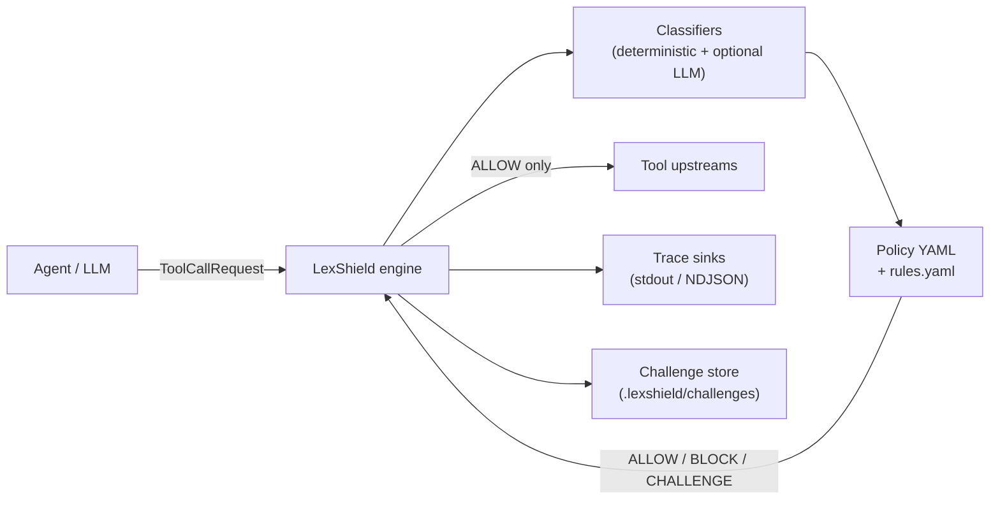

# LexShield 🛡️

<p align="center">
  <a href="https://github.com/LatticeAG/LexShield/blob/main/LICENSE">
    
  </a>
  <a href="https://github.com/LatticeAG/LexShield">
    
  </a>
  <a href="https://github.com/LatticeAG/LexShield">
    
  </a>
  <a href="https://github.com/LatticeAG/LexShield/stargazers">
    
  </a>
  <a href="https://github.com/LatticeAG/LexShield/issues">
    
  </a>
</p>

<p align="center">
  <b>The open-source policy firewall for AI agent tool calls.</b><br/>
  Classify. Enforce. Audit. Before execution.
</p>

<p align="center">
  <a href="#quick-start">Quick Start</a> ·
  <a href="#why-lexshield">Why LexShield</a> ·
  <a href="#architecture">Architecture</a> ·
  <a href="#features">Features</a> ·
  <a href="#monorepo-layout">Layout</a> ·
  <a href="#documentation">Docs</a>
</p>

---

LexShield sits between an AI agent and its tool fleet, classifies the intent behind each tool call, and enforces allow/block/challenge policy **before** execution. Fully local-first -- deterministic evaluation works with no API keys.

Built for AI safety teams and agent platform operators who need a defense-in-depth layer between autonomous agents and sensitive tool surfaces. MIT-licensed, self-hostable, with zero mandatory external dependencies.

## Why LexShield

- **Default-deny security** - every tool call is blocked until a policy explicitly allows it. No trust-once, permit-forever footguns.
- **Deterministic by default** - no API key required for core policy enforcement. Regex pattern matching and intent classification run locally, every time.
- **Multi-verdict policy engine** - `ALLOW`, `BLOCK`, `CHALLENGE`, and `DEFER` give you graduated control, not binary pass/fail.
- **Human-in-the-loop** - `CHALLENGE` verdicts queue for human approval. Agents pause, humans review, agents resume with signed webhooks.
- **Cross-platform SDKs** - Python and TypeScript SDKs with golden parity. Same deterministic behavior, same policy files, same audit traces.
- **Audit-native** - every evaluation appends to `traces.ndjson` with verdict, matched rule, and intent classification. Production-ready observability without extra tooling.

### How LexShield is different

- **Pre-execution, not post-hoc** - most agent safety tools *monitor* tool calls. LexShield *prevents* them. The shield evaluates before the tool runs, not after.
- **Intent classification layer** - not just URL/regex blocking. LexShield classifies the semantic intent of each tool call (`send_email`, `delete_resource`, `read_fs`) and applies intent-specific policies.
- **Local-first, no vendor lock-in** - the entire policy engine runs on your hardware with zero external API calls. No sending agent telemetry to a third party to get a verdict.

## Quick Start (5 minutes, deterministic-only)

No API key required.

```bash
# 1. Clone and install
git clone https://github.com/LatticeAG/LexShield.git
cd LexShield
uv sync

# 2. Scaffold config in a scratch directory
mkdir /tmp/lexshield-demo && cd /tmp/lexshield-demo
lexshield init --pack baseline-deny

# 3. Validate policy (CI-friendly)
lexshield check --strict

# 4. Evaluate a tool call offline
lexshield evaluate \
  --tool send_email \
  --args '{"to":"user@example.com","body":"«redacted:AKIA…»"}' \
  --json
# -> "decision": "BLOCK", "matchedRuleId": "block-secret-exposure"

lexshield evaluate --tool health_check --args '{}' --json
# -> "decision": "ALLOW", "matchedRuleId": "allow-health"
```

### TypeScript evaluate

```bash
pnpm install
pnpm --filter @latticeag/lexshield build
pnpm example:ts-evaluate
```

### Challenge flow (human approval)

```bash
cd examples/python-challenge-delete
uv run --project ../.. python main.py
# end-to-end: CHALLENGE -> CLI approve -> guarded delete succeeds
```

## Architecture



## Features

### Policy Engine

| Feature | Description |
|---------|------------|
| **Default-deny YAML policies** | Priority rules, globs, tags, and safe expressions. No implicit allow. |
| **Intent classification** | Deterministic tool maps + regex patterns; optional OpenAI-compatible LLM fallback for ambiguous calls. |
| **Multi-verdict system** | `ALLOW`, `BLOCK`, `CHALLENGE`, `DEFER` with audit-friendly reasons for every verdict. |
| **Policy packs** | `baseline-deny`, `pii-guard`, `change-window` -- drop-in policies for common guardrail scenarios. |

### SDK & CLI

| Feature | Description |
|---------|------------|
| **Python SDK** | `Shield.evaluate`, `@shield.guard` decorator, `await_challenge`, trace sinks |
| **TypeScript SDK** | `@latticeag/lexshield` with golden parity on all deterministic paths |
| **CLI** | `init`, `check`, `evaluate`, `run`, `traces`, `challenge`, `packs`, shell completion |
| **Local API** | FastAPI server on `127.0.0.1:8787` -- evaluate, execute, traces, challenge resolve |

### Audit & Observability

| Feature | Description |
|---------|------------|
| **Structured traces** | Every verdict appended to `traces.ndjson` with tool name, args, matched rule, latency |
| **Cross-engine golden parity** | Python and TypeScript engines tested against the same golden fixture suite |
| **Framework adapters** | Community patterns for Vercel AI SDK, LangChain, and OpenAI Agents SDK |

## Monorepo Layout

```text
lexshield/
├── packages/
│   ├── engine-py/          # Python policy engine + classifiers
│   ├── cli/                # lexshield Typer CLI
│   └── engine-ts/          # @latticeag/lexshield (TypeScript)
├── packs/                  # baseline-deny, pii-guard, change-window
├── fixtures/
│   └── golden/             # Cross-engine regression scenarios
├── examples/
│   ├── python-block-exfil/       # BLOCK on AWS key in send_email
│   ├── python-challenge-delete/  # CHALLENGE + CLI approve + execution
│   └── ts-evaluate/              # TypeScript evaluate() demo
├── contrib/                # Community framework adapters
├── docs/                   # policy.md, intents.md, sdk-python.md, sdk-typescript.md, cli.md, security.md
├── SPEC.md                 # Full architecture + policy language spec
├── LICENSE                 # MIT
└── README.md               # This file
```

## Documentation

| Doc | Topic |
|-----|-------|
| [docs/policy.md](./docs/policy.md) | Policy authoring language |
| [docs/intents.md](./docs/intents.md) | Intent catalog and taxonomy |
| [docs/sdk-python.md](./docs/sdk-python.md) | Python SDK reference |
| [docs/sdk-typescript.md](./docs/sdk-typescript.md) | TypeScript SDK reference |
| [docs/integrations.md](./docs/integrations.md) | Framework adapters |
| [docs/cli.md](./docs/cli.md) | CLI command reference |
| [docs/security.md](./docs/security.md) | Threat model and assumptions |

## Acceptance

```bash
# v0.1 acceptance suite (matches SPEC Appendix D)
uv sync && uv run pytest && uv run lexshield-check-packs \
  && pnpm install && pnpm test && pnpm test:golden \
  && pnpm example:ts-evaluate
```

## Development

```bash
# Python
uv sync
uv run pytest

# TypeScript
pnpm install
pnpm test
pnpm test:golden

# Policy packs
uv run lexshield-check-packs

# Full acceptance
make acceptance   # scripts/acceptance_v01.py
```

CI runs on every push -- [.github/workflows/ci.yml](./.github/workflows/ci.yml). Tag `v*` triggers release validation.

## Known Issues

- **LLM classifier latency** - When the optional LLM classifier is enabled, evaluation latency increases by 500-2000ms depending on provider. Deterministic-only mode has no such overhead.
- **Large policy trees** - Policy files with 100+ rules are validated and performant, but `lexshield check --strict` may take several seconds for very large rule sets. Break policies into focused packs where possible.
- **Challenge expiry** - Orphaned challenges (submitted but never resolved) have no built-in TTL in v0.1. Clean up `.lexshield/challenges/` manually or wire a cron job.

## License

MIT -- see [LICENSE](./LICENSE). Copyright &copy; 2026 LatticeAG.
