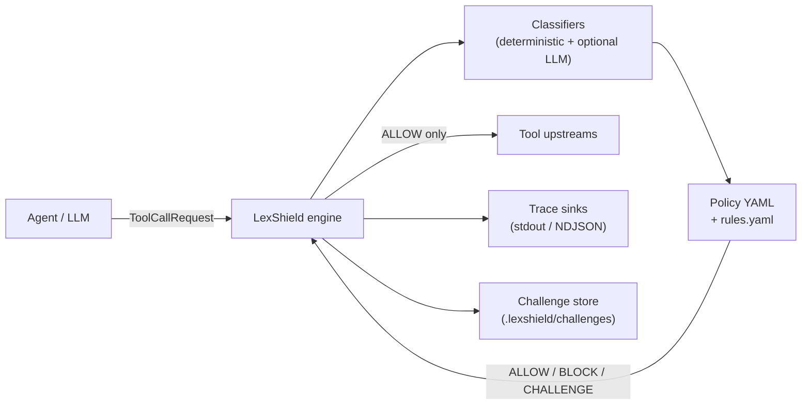

# LexShield

**The open-source policy firewall for agent tool calls.**

LexShield sits between an AI agent and its tool fleet, classifies the intent behind each tool call, and enforces allow/block/challenge policy **before** execution. Fully local-first — deterministic evaluation works with no API keys.

- **License**: MIT
- **Publisher**: [LatticeAG](https://latticeag.com)
- **Specification**: [SPEC.md](./SPEC.md)

## Architecture



## Features (v0.1)

| Area | Capability |
|------|------------|
| **Policy engine** | Default-deny YAML policies with priority rules, globs, tags, and safe expressions |
| **Classification** | Deterministic tool maps + regex patterns; optional OpenAI-compatible LLM fallback |
| **Verdicts** | `ALLOW`, `BLOCK`, `CHALLENGE`, `DEFER` with audit-friendly reasons |
| **Python SDK** | `Shield.evaluate`, `@shield.guard`, `await_challenge`, trace sinks |
| **TypeScript SDK** | `@latticeag/lexshield` with golden parity on deterministic paths |
| **CLI** | `init`, `check`, `evaluate`, `run`, `traces`, `challenge`, `packs`, shell completion |
| **Local API** | FastAPI on `127.0.0.1:8787` — evaluate, execute, traces, challenge resolve |
| **Policy packs** | `baseline-deny`, `pii-guard`, `change-window` |
| **Human approval** | File-based challenge queue + `lexshield challenge approve` |

## Quickstart (5 minutes, deterministic-only)

No API key required. These steps were verified against this repository.

```bash
# 1. Clone and install (Python SDK + CLI)
git clone https://github.com/latticeag/lexshield.git
cd lexshield
uv sync

# 2. Scaffold config in a scratch directory
mkdir /tmp/lexshield-demo && cd /tmp/lexshield-demo
lexshield init --pack baseline-deny    # uses uv/venv lexshield on PATH after uv sync

# 3. Validate policy (CI-friendly)
lexshield check --strict

# 4. Evaluate a tool call offline
lexshield evaluate \
  --tool send_email \
  --args '{"to":"user@example.com","body":"AKIA0123456789012345"}' \
  --json
# → "decision": "BLOCK", "matchedRuleId": "block-secret-exposure"

lexshield evaluate --tool health_check --args '{}' --json
# → "decision": "ALLOW", "matchedRuleId": "allow-health"
```

> **Tip:** After `uv sync`, run CLI commands via `uv run lexshield …` from the repo root, or use the `.venv/bin/lexshield` binary directly.

### Path outline

1. **Install** — `uv sync` (monorepo) or `pip install lexshield` (PyPI)
2. **Init** — `lexshield init` writes `lexshield.yaml`, `policy.yaml`, `rules.yaml`
3. **Check** — `lexshield check` validates policy in CI (`uv run lexshield-check-packs` for all packs)
4. **Evaluate** — `lexshield evaluate` or `Shield.guard` before tool execution
5. **Trace** — verdicts append to `traces.ndjson` when a file sink is configured

### TypeScript evaluate

```bash
pnpm install
pnpm --filter @latticeag/lexshield build
pnpm example:ts-evaluate
```

### Challenge flow (human approval)

```bash
cd examples/python-challenge-delete
uv run --project ../.. python main.py
# end-to-end: CHALLENGE → CLI approve → guarded delete succeeds
```

See [examples/README.md](./examples/README.md) and [docs/cli.md](./docs/cli.md).

## Acceptance command

Run the v0.1 acceptance suite from the repository root (matches [SPEC Appendix D](./SPEC.md#appendix-d--v01-acceptance-checklist)):

```bash
uv sync && uv run pytest && uv run lexshield-check-packs \
  && pnpm install && pnpm test && pnpm test:golden \
  && pnpm example:ts-evaluate
```

Or use the Makefile shortcut when available:

```bash
make acceptance   # scripts/acceptance_v01.py
```

## Documentation

| Doc | Topic |
|-----|-------|
| [docs/policy.md](./docs/policy.md) | Policy authoring |
| [docs/intents.md](./docs/intents.md) | Intent catalog |
| [docs/sdk-python.md](./docs/sdk-python.md) | Python SDK |
| [docs/sdk-typescript.md](./docs/sdk-typescript.md) | TypeScript SDK |
| [docs/integrations.md](./docs/integrations.md) | Framework adapters (contrib) |
| [docs/cli.md](./docs/cli.md) | CLI reference |
| [docs/security.md](./docs/security.md) | Threat model |

## Examples

| Example | Description |
|---------|-------------|
| [python-block-exfil](./examples/python-block-exfil/) | `BLOCK` on AWS key in `send_email` |
| [python-challenge-delete](./examples/python-challenge-delete/) | `CHALLENGE` prod delete + CLI approve + execution |
| [ts-evaluate](./examples/ts-evaluate/) | TypeScript `evaluate()` demo |

## Framework adapters (contrib)

Community copy-paste patterns for Vercel AI SDK, LangChain, and OpenAI Agents — **not officially supported**. See [contrib/](./contrib/) and [docs/integrations.md](./docs/integrations.md).

## Monorepo layout

| Package | Path | Role |
|---------|------|------|
| Python engine | `packages/engine-py` | Policy engine, classifiers |
| Python CLI | `packages/cli` | `lexshield` Typer CLI |
| TypeScript SDK | `packages/engine-ts` | `@latticeag/lexshield` |
| Policy packs | `packs/` | `baseline-deny`, `pii-guard`, `change-window` |
| Golden fixtures | `fixtures/golden/` | Cross-engine regression scenarios |

## Development

```bash
make test         # pytest + pnpm test + golden parity
make acceptance   # SPEC Appendix D checklist (scripts/acceptance_v01.py)
make build        # TypeScript SDK (no publish)
```

See [CONTRIBUTING.md](./CONTRIBUTING.md) for full setup.

```bash
# Python
uv sync
uv run pytest

# TypeScript
pnpm install
pnpm test
pnpm test:golden

# Policy packs
uv run lexshield-check-packs
```

CI runs on every push — [.github/workflows/ci.yml](./.github/workflows/ci.yml). Tag `v*` triggers [.github/workflows/release.yml](./.github/workflows/release.yml) (build validation only, no publish).

See [SPEC.md](./SPEC.md) for architecture, policy language, intent taxonomy, and v0.1 acceptance criteria.
